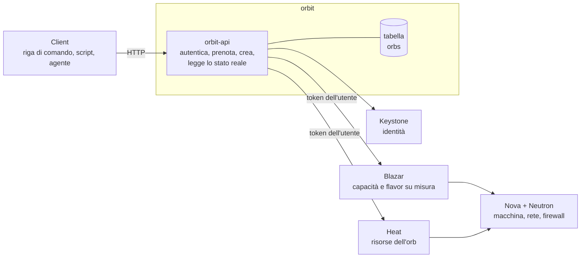
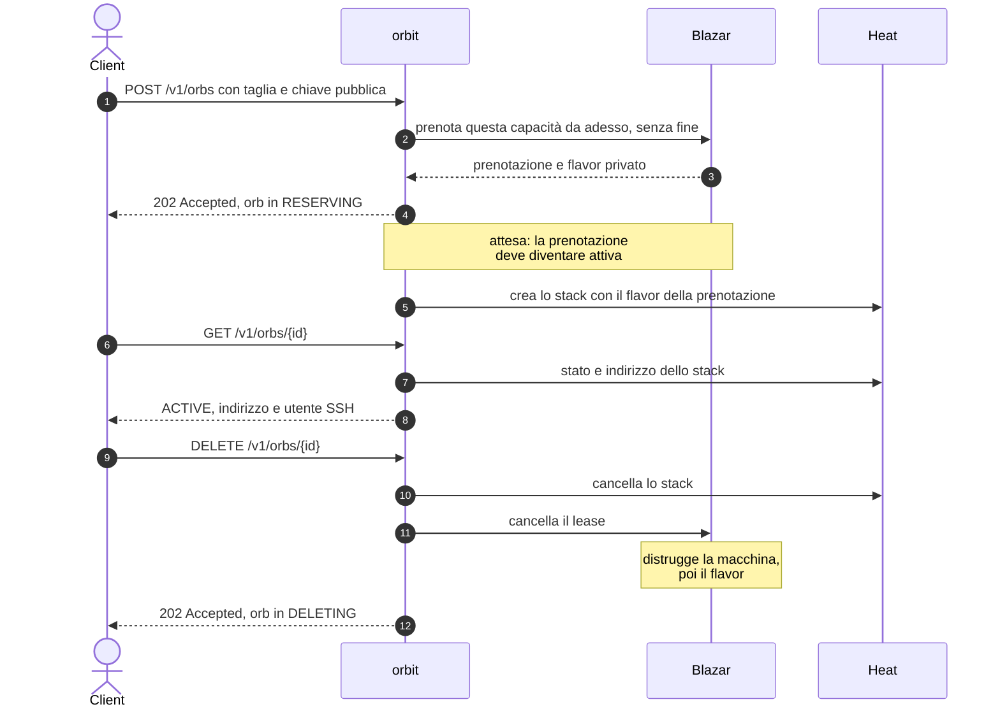
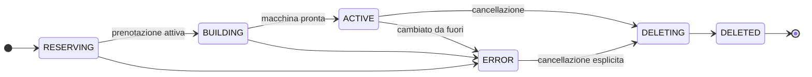

# orbit

**Sandbox effimere come servizio OpenStack.** Un client chiede "una macchina con queste risorse"; il servizio gliela consegna isolata e raggiungibile in SSH, e quando il client ha finito la fa sparire per intero. Ogni sandbox è un **orb**.

---

## Scheda

| | |
| --- | --- |
| **Tipo** | nuovo servizio OpenStack, non un'estensione di un servizio esistente |
| **Ambiente** | DevStack, installato tramite plugin |
| **Linguaggio** | Python |
| **Componenti integrati** | Keystone, Blazar, Heat; Nova e Neutron indirettamente |
| **Interfacce** | API REST, plugin per `openstack` da riga di comando |
| **Risorsa gestita** | l'*orb*: una macchina isolata, con capacità prenotata su misura e le sue risorse di contorno |
| **Stato** | implementazione in corso, nulla ancora verificato su DevStack |

---

## Il problema

Chi esegue lavori non fidati o distruttivi — compilazioni, test, un agente che modifica un repository — ha bisogno di una macchina intera, non di una cartella. Quella macchina deve essere **isolata**, **dimensionata sul lavoro** e, quando il lavoro finisce, deve sparire **senza lasciare niente dietro**: né la macchina, né la chiave, né il firewall, né l'indirizzo.

Fatto a mano, con una manciata di comandi `openstack`, ognuno di questi punti si rompe: le taglie disponibili sono quelle del catalogo, una macchina può non trovare posto dopo che il resto è già stato creato, una creazione fallita a metà lascia pezzi sparsi, una cancellazione dimenticata lascia un indirizzo occupato. `orbit` tratta la sandbox come un oggetto unico, l'orb, che nasce intero e muore intero.

## Cosa fa

- Accetta la **taglia** richiesta — processori, memoria, disco — orb per orb, senza cataloghi di dimensioni prefissate.
- **Prenota la capacità** prima di costruire: se non c'è posto lo dice subito, invece di fallire a metà.
- Crea l'orb nel **progetto di chi lo chiede**: compare fra le sue risorse e consuma la sua quota.
- Installa la **chiave pubblica fornita dal client** e restituisce indirizzo e utente per l'accesso SSH.
- **Cancella tutto** con una sola richiesta, ripetibile senza errore: capacità, flavor, macchina e risorse di contorno.
- **Dice la verità** sullo stato: ogni lettura guarda le risorse reali, quindi una macchina cancellata a mano non lascia un orb che mente.

## Cosa non fa

Non entra nell'orb: non esegue comandi, non copia file, non sa cosa ci gira dentro. Consegna un indirizzo e si fa da parte. Non decide quando un orb deve finire: lo decide chi l'ha chiesto. Non conserva token né deleghe. Non prepara immagini, non fa da proxy, non gestisce più di una macchina per orb.

---

## Architettura



Il servizio **non crea risorse da sé**: chiede la capacità a Blazar e le risorse a Heat, sempre col token di chi le chiede. Blazar trasforma la taglia in un flavor privato e, alla cancellazione, distrugge macchina e flavor nell'ordine giusto. Heat costruisce e distrugge chiave, firewall, porta, indirizzo e macchina come un blocco unico.

Un solo processo, `orbit-api`. Il lavoro che segue la risposta — attendere che la prenotazione si attivi e creare lo stack — dura pochi secondi e gira dentro lo stesso processo, col token della richiesta tenuto in memoria.

---

## Ciclo di vita di un orb



L'attesa al passaggio 5 è necessaria: Blazar crea il flavor subito, ma il progetto può usarlo solo quando la prenotazione è attiva, cioè entro una decina di secondi. La data di fine del lease è fissata lontanissima perché Blazar la esige: la vita dell'orb la decide `DELETE`, non il calendario.

---

## Stati di un orb



`RESERVING` e `BUILDING` sono due stati distinti perché sono due attese diverse: la prima aspetta che la capacità diventi utilizzabile, la seconda che le risorse esistano. Lo stato non lo decide il servizio: lo osserva, chiedendo a ogni lettura a Blazar, Heat e Nova com'è davvero l'orb. Un orb in `ERROR` non si cancella da sé: le risorse restano osservabili finché qualcuno non chiede esplicitamente di rimuoverle.

---

## Interfaccia

| Metodo e percorso | Effetto |
| --- | --- |
| `POST /v1/orbs` | prenota la capacità e avvia la costruzione; risponde subito |
| `GET /v1/orbs` | elenca gli orb del proprio progetto |
| `GET /v1/orbs/{id}` | stato, indirizzo SSH, eventuale motivo dell'errore |
| `DELETE /v1/orbs/{id}` | fa sparire l'orb; ripetibile senza errore |

```jsonc
// POST /v1/orbs
{
  "size": { "vcpus": 2, "memory_mb": 4096, "disk_gb": 20 },
  "public_key": "ssh-ed25519 AAAA...",
  "image": "ubuntu-24.04"
}
```

Il contratto completo, con codici di errore e transizioni, è in [docs/design/api.md](docs/design/api.md).

---

## Documenti

| Documento | Contenuto |
| --- | --- |
| [CONTEXT](CONTEXT.md) | glossario del dominio e dei termini OpenStack usati |
| [Architettura](docs/architettura.md) | confini di proprietà, sequenza completa, requisiti di installazione |
| [Contratto della API](docs/design/api.md) | risorse HTTP, stati, errori |
| [Stato conservato](docs/design/stato.md) | la tabella del servizio e il riallineamento |
| [Template dell'orb](orbit/templates/orb.yaml) | descrizione Heat delle risorse di un orb |
| [Decisioni](docs/adr/) | le cinque scelte di forma, con motivazione e fonti |

## Stato dei lavori

- [x] Decisioni di forma registrate, con fonti verificate
- [x] Contratto della API, stati e schema dei dati
- [x] Template dell'orb
- [x] Plugin DevStack e scheletro eseguibile del servizio, da verificare su DevStack
- [x] Tabella `orbs` e accesso ai dati, da verificare su DevStack
- [x] Prenotazione della capacità, da verificare su DevStack
- [x] Attesa della prenotazione e creazione dello stack, da verificare su DevStack
- [ ] Lettura dello stato reale e cancellazione
- [ ] Plugin per `openstack` da riga di comando
- [ ] Test automatici
- [ ] Installazione e percorso completo verificati su DevStack

Il codice viene scritto prima della verifica su DevStack, che è l'ultimo passo: finché non è stata fatta, nessun componente è stato installato e le affermazioni tecniche nei documenti restano tratte dalla documentazione ufficiale o dal codice sorgente di OpenStack, con il collegamento alla fonte accanto.
