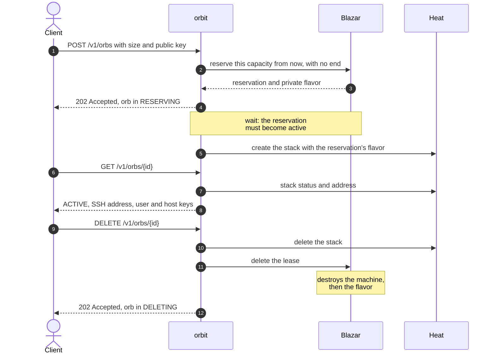

<p align="center">
  
</p>

<h1 align="center">orbit</h1>

<p align="center">
  
  
  
  <br>
  
  
</p>

**Ephemeral sandboxes as an OpenStack service.** A client asks for "a machine with these resources"; the service hands it over isolated and reachable over SSH, and when the client is done it makes it disappear entirely. Each sandbox is an **orb**.

---

## The problem

Whoever runs untrusted or destructive work, such as builds, tests or an agent editing a repository, needs a whole machine, not a folder. That machine must be **isolated**, **sized to the work** and, when the work ends, it must disappear **without leaving anything behind**: not the machine, not the key, not the firewall, not the address.

Done by hand, with a handful of `openstack` commands, each of these points breaks: the available sizes are those in the catalog, a machine may find no room after everything else has been created, a creation that fails halfway leaves scattered pieces, a forgotten deletion leaves an address taken. `orbit` treats the sandbox as a single object, the orb, which is born whole and dies whole.

## What it does

- Accepts the requested **size** (processors, memory, disk) orb by orb, without catalogs of fixed sizes.
- **Reserves the capacity** before building: if there is no room it says so right away, instead of failing halfway.
- Creates the orb in the **project of whoever asks for it**: it appears among their resources and consumes their quota.
- Installs the **public key supplied by the client** and returns address, user and the machine's **host keys** for SSH access, so the client verifies whom it connects to.
- Admits SSH only from the **network the client names** in each request: one address or a small network, within an optional cap set by the operator.
- **Deletes everything** with a single request, repeatable without error: capacity, flavor, machine and surrounding resources.
- **Tells the truth** about the status: every read looks at the real resources, so a machine deleted by hand does not leave behind an orb that lies.

## What it does not do

It does not enter the orb: it does not run commands, does not copy files, does not know what runs inside. It hands over an address and steps aside. It does not decide when an orb must end: whoever asked for it decides. It keeps no tokens or delegations. It does not prepare images, does not act as a proxy, does not manage more than one machine per orb.

---

## Lifecycle of an orb



---

## Interface

The REST API, `/v1/orbs`, is described in [docs/design/api.md](docs/design/api.md). From the command line: `openstack orb create | list | show | delete`. In Horizon: the read-only **Project → Orbit → Orbs** panel.

---

## Quick start

1. Clone DevStack:

   ```console
   $ git clone https://opendev.org/openstack/devstack
   $ cd devstack
   ```

2. Write `local.conf`, enabling orbit after the Heat and Blazar plugins it depends on:

   ```console
   $ cat > local.conf <<'EOF'
   [[local|localrc]]
   ADMIN_PASSWORD=secret
   DATABASE_PASSWORD=$ADMIN_PASSWORD
   RABBIT_PASSWORD=$ADMIN_PASSWORD
   SERVICE_PASSWORD=$ADMIN_PASSWORD
   enable_plugin heat   https://opendev.org/openstack/heat
   enable_plugin blazar https://opendev.org/openstack/blazar
   enable_plugin orbit  https://github.com/taekwondodev/orbit
   EOF
   ```

3. Install:

   ```console
   $ ./stack.sh
   ```

4. Act as the `demo` project:

   ```console
   $ source openrc demo demo
   ```

5. Create an orb and wait until it is `ACTIVE`. `<your-address>` is the address the orb sees you connect from: the firewall admits SSH from it only. On the DevStack host it is `172.24.4.1`. From another machine, first run `tools/reach-orbs.sh <host>` there, again after either machine restarts, and use that machine's address on the network it shares with the host.

   ```console
   $ openstack orb create --vcpus 1 --memory 512 --disk 1 \
         --public-key ~/.ssh/id_ed25519.pub \
         --ssh-allowed-cidr <your-address>/32 --wait
   ```

6. See it in Horizon too: at `http://<host>/dashboard`, log in as `demo` with the `ADMIN_PASSWORD`, pick the `demo` project in the project menu at the top, and open **Project → Orbit → Orbs**. DevStack gives `demo` no default project, so Horizon may open `invisible_to_admin` instead, where the list is empty.

7. Connect with the `ssh_user` and `ssh_host` printed in step 5, verifying the host against the `ssh_host_keys` printed with them:

   ```console
   $ openstack orb show <id> -f json -c ssh_host -c ssh_host_keys \
         | jq -r '.ssh_host as $h | .ssh_host_keys[] | "\($h) \(.)"' > orb_known_hosts
   $ ssh -o UserKnownHostsFile=orb_known_hosts -o StrictHostKeyChecking=yes \
         <ssh_user>@<ssh_host>
   ```

8. Delete the orb and everything it holds:

   ```console
   $ openstack orb delete <id>
   ```

9. Run the unit tests, which need no OpenStack:

   ```console
   $ cd /opt/stack/orbit
   $ tox -e py3
   $ tox -e dashboard   # the Horizon panel; Python 3.11 or later
   ```

What each plugin does and what the installation requires: [docs/architecture.md](docs/architecture.md#installation).

---

## Documents

| Document | Content |
| --- | --- |
| [GLOSSARY](GLOSSARY.md) | glossary of the domain and of the OpenStack terms used |
| [Architecture](docs/architecture.md) | ownership boundaries, composition of an orb, full sequence, installation requirements |
| [API contract](docs/design/api.md) | HTTP resources, statuses, errors |
| [Stored state](docs/design/state.md) | the service's table and reconciliation |
| [Orb template](orbit/templates/orb.yaml) | Heat description of an orb's resources |
| [Decisions](docs/adr/) | the shape choices, with rejected alternatives and sources |
