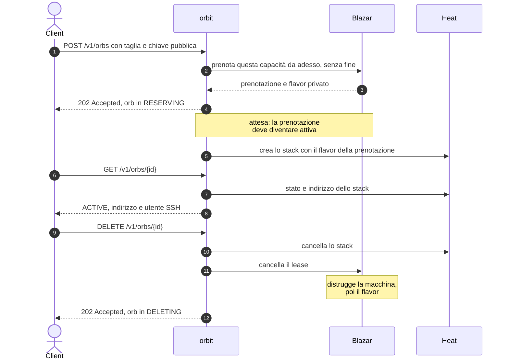

# orbit

**Sandbox effimere come servizio OpenStack.** Un client chiede "una macchina con queste risorse"; il servizio gliela consegna isolata e raggiungibile in SSH, e quando il client ha finito la fa sparire per intero. Ogni sandbox è un **orb**.

---

## Scheda

| | |
| --- | --- |
| **Tipo** | nuovo servizio OpenStack, non un'estensione di un servizio esistente |
| **Ambiente** | DevStack, installato tramite plugin |
| **Linguaggio** | Python |
| **Componenti integrati** | Keystone, Blazar, Heat; Nova e Neutron indirettamente |
| **Interfacce** | API REST, plugin per `openstack` da riga di comando |
| **Risorsa gestita** | l'*orb*: una macchina isolata, con capacità prenotata su misura e le sue risorse di contorno |

---

## Il problema

Chi esegue lavori non fidati o distruttivi, come compilazioni, test o un agente che modifica un repository, ha bisogno di una macchina intera, non di una cartella. Quella macchina deve essere **isolata**, **dimensionata sul lavoro** e, quando il lavoro finisce, deve sparire **senza lasciare niente dietro**: né la macchina, né la chiave, né il firewall, né l'indirizzo.

Fatto a mano, con una manciata di comandi `openstack`, ognuno di questi punti si rompe: le taglie disponibili sono quelle del catalogo, una macchina può non trovare posto dopo che il resto è già stato creato, una creazione fallita a metà lascia pezzi sparsi, una cancellazione dimenticata lascia un indirizzo occupato. `orbit` tratta la sandbox come un oggetto unico, l'orb, che nasce intero e muore intero.

## Cosa fa

- Accetta la **taglia** richiesta (processori, memoria, disco) orb per orb, senza cataloghi di dimensioni prefissate.
- **Prenota la capacità** prima di costruire: se non c'è posto lo dice subito, invece di fallire a metà.
- Crea l'orb nel **progetto di chi lo chiede**: compare fra le sue risorse e consuma la sua quota.
- Installa la **chiave pubblica fornita dal client** e restituisce indirizzo e utente per l'accesso SSH.
- **Cancella tutto** con una sola richiesta, ripetibile senza errore: capacità, flavor, macchina e risorse di contorno.
- **Dice la verità** sullo stato: ogni lettura guarda le risorse reali, quindi una macchina cancellata a mano non lascia un orb che mente.

## Cosa non fa

Non entra nell'orb: non esegue comandi, non copia file, non sa cosa ci gira dentro. Consegna un indirizzo e si fa da parte. Non decide quando un orb deve finire: lo decide chi l'ha chiesto. Non conserva token né deleghe. Non prepara immagini, non fa da proxy, non gestisce più di una macchina per orb.

---

## Architettura


Componenti, confini di proprietà e regole: [docs/architettura.md](docs/architettura.md).


Le risorse sono quelle del [template](orbit/templates/orb.yaml). Perché il lease sta fuori dallo stack: [0005](docs/adr/0005-prenotazione-accanto-allo-stack.md); perché ogni orb ha la sua rete: [0006](docs/adr/0006-rete-propria-per-ogni-orb.md).

---

## Ciclo di vita di un orb



Perché prima del passaggio 5 c'è un'attesa, e in che ordine si distrugge alla cancellazione: [docs/architettura.md](docs/architettura.md#sequenza-di-un-orb).

### Creazione


### Cancellazione


---

## Stati di un orb


Significato di ogni stato: [docs/design/api.md](docs/design/api.md#macchina-a-stati).


Come una lettura ricava lo stato: [docs/design/stato.md](docs/design/stato.md#riallineamento).


Codici di errore: [docs/design/api.md](docs/design/api.md#codici-di-errore).

---

## Interfaccia

La API REST, `/v1/orbs`, è descritta in [docs/design/api.md](docs/design/api.md). Da riga di comando: `openstack orb create | list | show | delete`.

---

## Provarlo


Nel `local.conf` di DevStack, con orbit dopo i plugin di Heat e Blazar da cui dipende; cosa fa ogni plugin e cosa richiede l'installazione è in [docs/architettura.md](docs/architettura.md#installazione):

```ini
[[local|localrc]]
enable_plugin heat   https://opendev.org/openstack/heat
enable_plugin blazar https://opendev.org/openstack/blazar
enable_plugin orbit  https://github.com/taekwondodev/orbit
# solo per i test tempest
TEMPEST_PLUGINS=/opt/stack/orbit
```

Dopo `./stack.sh`, col progetto `demo`:

```console
$ openstack orb create --vcpus 1 --memory 512 --disk 1 \
      --public-key ~/.ssh/id_ed25519.pub --wait
$ ssh <ssh_user>@<ssh_host>
$ openstack orb delete <id>
```

I test unitari girano senza OpenStack con `tox -e py3`; il percorso completo, compreso il rifiuto per capacità esaurita, con `tempest run --regex orbit` sull'installazione.

---

## Documenti

| Documento | Contenuto |
| --- | --- |
| [GLOSSARY](GLOSSARY.md) | glossario del dominio e dei termini OpenStack usati |
| [Architettura](docs/architettura.md) | confini di proprietà, sequenza completa, requisiti di installazione |
| [Contratto della API](docs/design/api.md) | risorse HTTP, stati, errori |
| [Stato conservato](docs/design/stato.md) | la tabella del servizio e il riallineamento |
| [Template dell'orb](orbit/templates/orb.yaml) | descrizione Heat delle risorse di un orb |
| [Decisioni](docs/adr/) | le scelte di forma, con alternative scartate e fonti |
