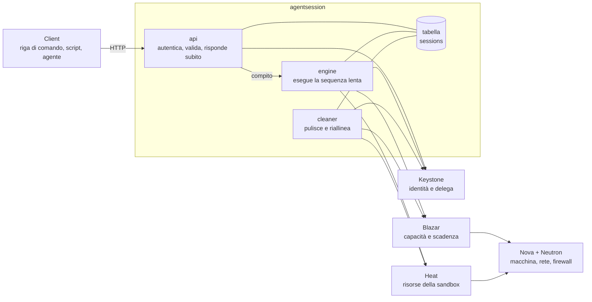
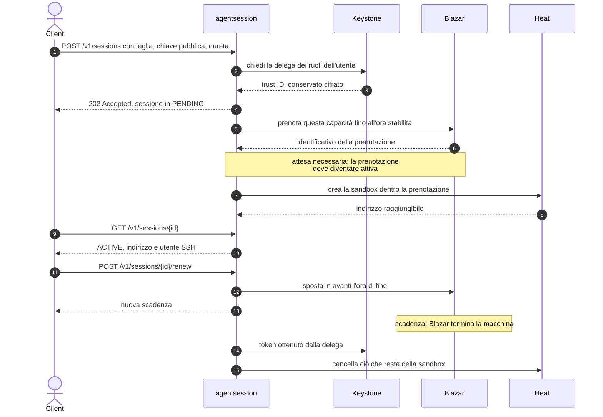
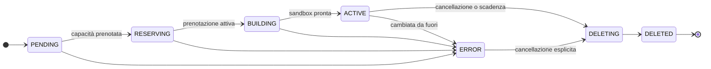

# agentsession

**Sandbox effimere come servizio OpenStack.** Un client chiede "una macchina con queste risorse, per due ore"; il servizio gliela consegna isolata e raggiungibile in SSH, e la riprende da sé quando il tempo finisce.

---

## Scheda

| | |
| --- | --- |
| **Tipo** | nuovo servizio OpenStack, non un'estensione di un servizio esistente |
| **Ambiente** | DevStack, installato tramite plugin |
| **Linguaggio** | Python |
| **Componenti integrati** | Keystone, Blazar, Heat; Nova e Neutron indirettamente |
| **Interfacce** | API REST, plugin per `openstack` da riga di comando |
| **Risorsa gestita** | la *sessione*: il diritto a usare una macchina virtuale fino a un'ora stabilita |
| **Stato** | progettazione conclusa, implementazione da iniziare |

---

## Il problema

Chi esegue lavori non fidati o distruttivi — compilazioni, test, un agente che modifica un repository — ha bisogno di una macchina intera, non di una cartella. Due esigenze si scontrano: la macchina deve essere **isolata** e **dimensionata sul lavoro**, ma nessuno si ricorda di spegnerla quando il lavoro finisce. Una macchina dimenticata resta accesa per giorni e consuma capacità che serviva a qualcun altro.

`agentsession` tratta quindi la macchina come un **prestito a termine** invece che come una risorsa creata e abbandonata: ogni sandbox nasce con un'ora di scadenza già scritta, chi la sta usando può prolungarla, e nessuno deve ricordarsi di nulla.

## Cosa fa

- Accetta la **taglia** richiesta — processori, memoria, disco — sessione per sessione, senza cataloghi di dimensioni prefissate.
- Crea la sandbox nel **progetto di chi la chiede**: compare fra le sue risorse e consuma la sua quota.
- Installa la **chiave pubblica fornita dal client** e restituisce indirizzo e utente per l'accesso SSH.
- **Prolunga** una sessione viva, se il lavoro dura più del previsto.
- **Riprende** le risorse alla scadenza e cancella ciò che resta, senza intervento umano.
- Si **riallinea** quando la realtà cambia da fuori: una macchina cancellata a mano non lascia una sessione che mente.

## Cosa non fa

Non entra nella sandbox: non esegue comandi, non copia file, non sa cosa ci gira dentro. Consegna un indirizzo e si fa da parte. Non prepara immagini, non fa da proxy, non gestisce più di una macchina per sessione.

---

## Architettura



Il servizio **non crea risorse**: le descrive e le fa creare. La divisione fra i tre processi segue il tempo di risposta, non la simmetria: una richiesta HTTP dura millisecondi, costruire una sandbox dura minuti, riprenderla avviene quando nessuno sta chiedendo niente.

| Processo | Responsabilità |
| --- | --- |
| `agentsession-api` | riceve le richieste, verifica il token, valida la taglia, registra la sessione e risponde `202` |
| `agentsession-engine` | ottiene la delega, prenota la capacità, attende, crea la sandbox, aggiorna lo stato |
| `agentsession-cleaner` | cancella ciò che la scadenza ha reso orfano e corregge lo stato quando la realtà è cambiata |

---

## Ciclo di vita di una sessione



Il passaggio 15 è la ragione per cui esiste il `cleaner`: alla scadenza viene ripresa la macchina, non tutto il resto. Senza quel passaggio ogni sessione lascerebbe dietro una chiave, un firewall e un indirizzo.

---

## Stati di una sessione



`RESERVING` e `BUILDING` sono due stati distinti perché sono due attese diverse: la prima aspetta che la capacità venga concessa, la seconda che le risorse esistano. Una sessione in `ERROR` non si cancella da sé: le risorse restano osservabili finché qualcuno non chiede esplicitamente di rimuoverle.

---

## Interfaccia

| Metodo e percorso | Effetto |
| --- | --- |
| `POST /v1/sessions` | chiede una sandbox; risponde subito, la costruzione continua |
| `GET /v1/sessions` | elenca le sessioni del proprio progetto |
| `GET /v1/sessions/{id}` | stato, indirizzo SSH, scadenza, eventuale motivo dell'errore |
| `POST /v1/sessions/{id}/renew` | sposta in avanti la scadenza di una sessione viva |
| `DELETE /v1/sessions/{id}` | riprende tutto; ripetibile senza errore |

```jsonc
// POST /v1/sessions
{
  "size": { "vcpus": 2, "memory_mb": 4096, "disk_gb": 20 },
  "public_key": "ssh-ed25519 AAAA...",
  "image": "ubuntu-24.04",
  "ttl_seconds": 7200
}
```

Il contratto completo, con codici di errore e transizioni, è in [docs/design/api.md](docs/design/api.md).

---

## Documenti

| Documento | Contenuto |
| --- | --- |
| [CONTEXT](CONTEXT.md) | glossario del dominio e dei termini OpenStack usati |
| [Architettura](docs/architettura.md) | confini di proprietà, sequenza completa, requisiti di installazione |
| [Contratto della API](docs/design/api.md) | risorse HTTP, stati, errori |
| [Stato conservato](docs/design/stato.md) | la tabella del servizio e il riallineamento |
| [Template della sandbox](templates/sandbox.yaml) | descrizione Heat delle risorse di una sessione |
| [Decisioni](docs/adr/) | le cinque scelte di forma, con motivazione e fonti |

## Stato dei lavori

- [x] Decisioni di forma registrate, con fonti verificate
- [x] Contratto della API, stati e schema dei dati
- [x] Template della sandbox
- [ ] Plugin DevStack e scheletro eseguibile del servizio
- [ ] Prenotazione, delega e creazione della sandbox
- [ ] Rinnovo, scadenza e riallineamento
- [ ] Plugin per `openstack` da riga di comando
- [ ] Test automatici

Nessun componente è stato ancora installato: tutte le affermazioni tecniche nei documenti sono tratte dalla documentazione ufficiale o dal codice sorgente di OpenStack, con il collegamento alla fonte accanto.
