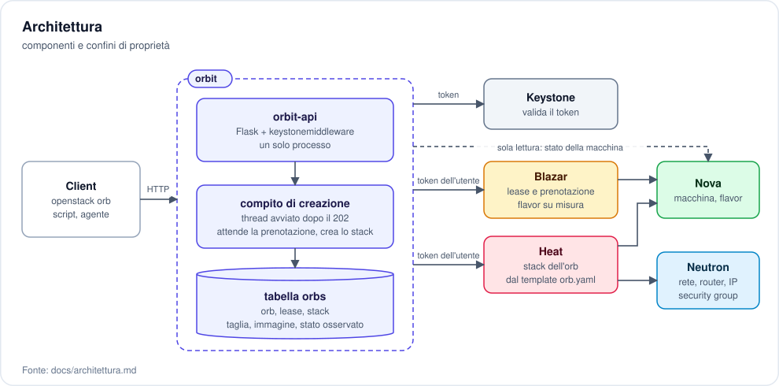
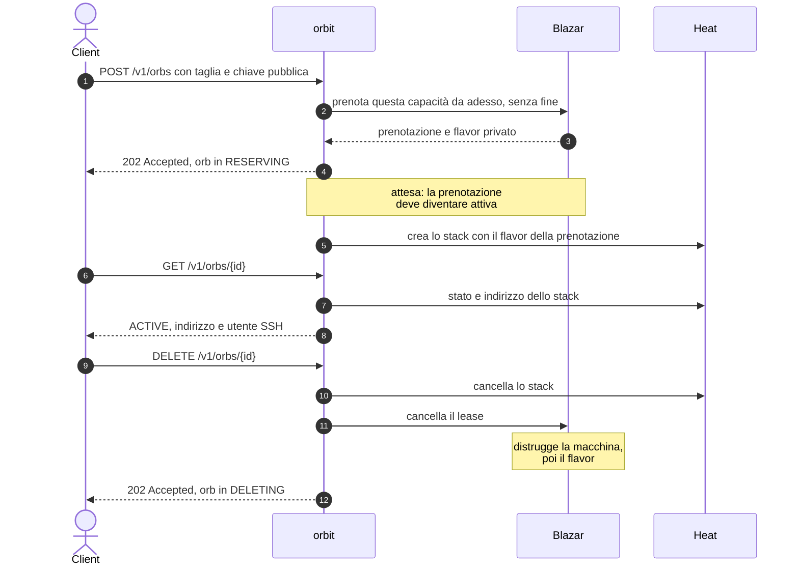
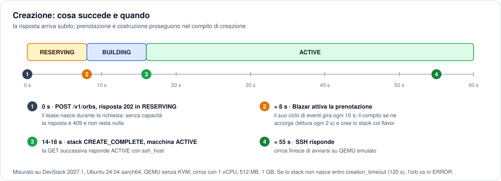
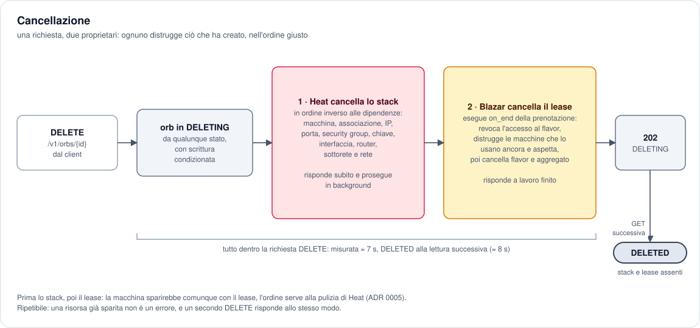
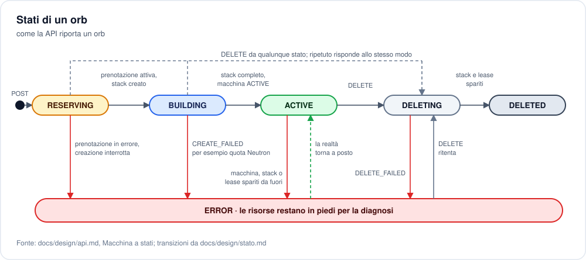
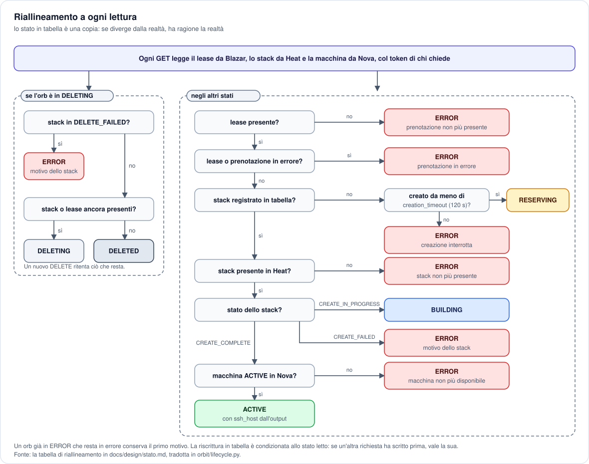
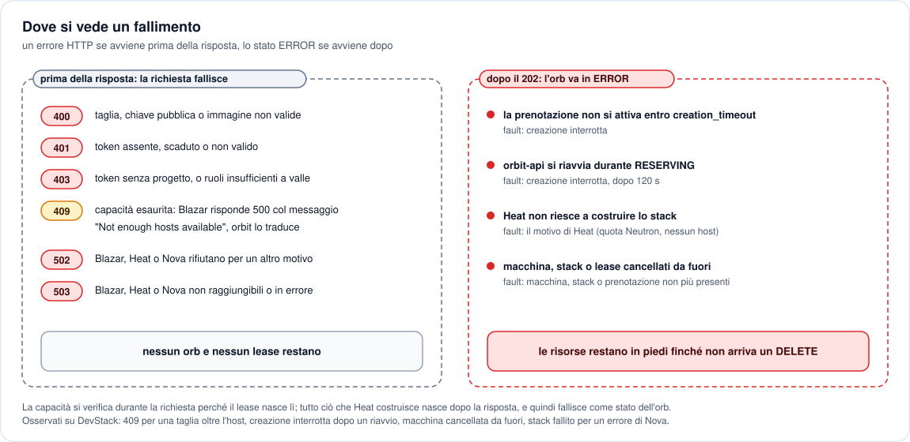
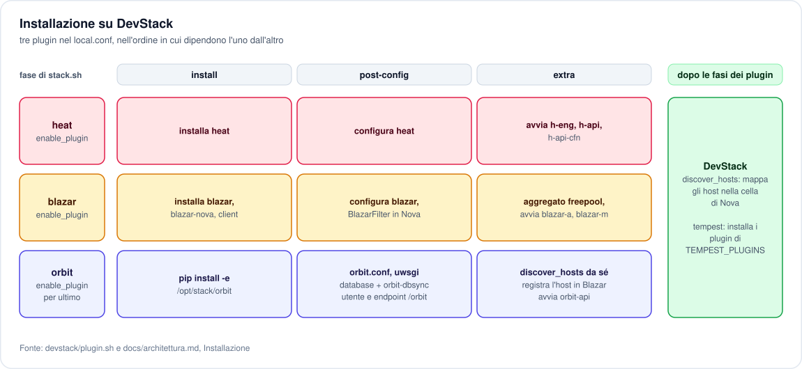

# orbit

**Sandbox effimere come servizio OpenStack.** Un client chiede "una macchina con queste risorse"; il servizio gliela consegna isolata e raggiungibile in SSH, e quando il client ha finito la fa sparire per intero. Ogni sandbox è un **orb**.

---

## Scheda

| | |
| --- | --- |
| **Tipo** | nuovo servizio OpenStack, non un'estensione di un servizio esistente |
| **Ambiente** | DevStack, installato tramite plugin |
| **Linguaggio** | Python |
| **Componenti integrati** | Keystone, Blazar, Heat; Nova e Neutron indirettamente |
| **Interfacce** | API REST, plugin per `openstack` da riga di comando |
| **Risorsa gestita** | l'*orb*: una macchina isolata, con capacità prenotata su misura e le sue risorse di contorno |
| **Stato** | installazione e percorso completo verificati su DevStack |

---

## Il problema

Chi esegue lavori non fidati o distruttivi, come compilazioni, test o un agente che modifica un repository, ha bisogno di una macchina intera, non di una cartella. Quella macchina deve essere **isolata**, **dimensionata sul lavoro** e, quando il lavoro finisce, deve sparire **senza lasciare niente dietro**: né la macchina, né la chiave, né il firewall, né l'indirizzo.

Fatto a mano, con una manciata di comandi `openstack`, ognuno di questi punti si rompe: le taglie disponibili sono quelle del catalogo, una macchina può non trovare posto dopo che il resto è già stato creato, una creazione fallita a metà lascia pezzi sparsi, una cancellazione dimenticata lascia un indirizzo occupato. `orbit` tratta la sandbox come un oggetto unico, l'orb, che nasce intero e muore intero.

## Cosa fa

- Accetta la **taglia** richiesta (processori, memoria, disco) orb per orb, senza cataloghi di dimensioni prefissate.
- **Prenota la capacità** prima di costruire: se non c'è posto lo dice subito, invece di fallire a metà.
- Crea l'orb nel **progetto di chi lo chiede**: compare fra le sue risorse e consuma la sua quota.
- Installa la **chiave pubblica fornita dal client** e restituisce indirizzo e utente per l'accesso SSH.
- **Cancella tutto** con una sola richiesta, ripetibile senza errore: capacità, flavor, macchina e risorse di contorno.
- **Dice la verità** sullo stato: ogni lettura guarda le risorse reali, quindi una macchina cancellata a mano non lascia un orb che mente.

## Cosa non fa

Non entra nell'orb: non esegue comandi, non copia file, non sa cosa ci gira dentro. Consegna un indirizzo e si fa da parte. Non decide quando un orb deve finire: lo decide chi l'ha chiesto. Non conserva token né deleghe. Non prepara immagini, non fa da proxy, non gestisce più di una macchina per orb.

---

## Architettura



Il servizio **non crea risorse da sé**: chiede la capacità a Blazar e le risorse a Heat, sempre col token di chi le chiede. Un solo processo, `orbit-api`: il lavoro che segue la risposta, cioè attendere che la prenotazione si attivi e creare lo stack, dura pochi secondi e gira in un thread dello stesso processo, col token della richiesta tenuto in memoria.


Un orb è una riga della tabella `orbs` che lega due oggetti altrui. Blazar possiede la capacità e il flavor su misura e, alla cancellazione, distrugge macchina e flavor nell'ordine giusto. Heat costruisce e distrugge il resto come un blocco unico, rete e router compresi: ogni orb ha la sua rete ([0006](docs/adr/0006-rete-propria-per-ogni-orb.md)). Il lease resta fuori dallo stack perché Heat non aspetterebbe la prenotazione attiva ([0005](docs/adr/0005-prenotazione-accanto-allo-stack.md)).

---

## Ciclo di vita di un orb



L'attesa al passaggio 5 è necessaria: Blazar crea il flavor subito, ma il progetto può usarlo solo quando la prenotazione è attiva. La data di fine del lease è fissata lontanissima perché Blazar la esige: la vita dell'orb la decide `DELETE`, non il calendario ([0003](docs/adr/0003-nessuna-scadenza.md)).

### Creazione



### Cancellazione



---

## Stati di un orb



Lo stato non lo decide il servizio: lo osserva. Ogni lettura chiede a Blazar, Heat e Nova com'è davvero l'orb e corregge la tabella, secondo questa catena di controlli:



### Dove si vede un fallimento



---

## Interfaccia

| Metodo e percorso | Effetto |
| --- | --- |
| `POST /v1/orbs` | prenota la capacità e avvia la costruzione; risponde subito |
| `GET /v1/orbs` | elenca gli orb del proprio progetto |
| `GET /v1/orbs/{id}` | stato, indirizzo SSH, eventuale motivo dell'errore |
| `DELETE /v1/orbs/{id}` | fa sparire l'orb; ripetibile senza errore |

```jsonc
// POST /v1/orbs
{
  "size": { "vcpus": 2, "memory_mb": 4096, "disk_gb": 20 },
  "public_key": "ssh-ed25519 AAAA...",
  "image": "ubuntu-24.04"
}
```

Il contratto completo, con codici di errore e transizioni, è in [docs/design/api.md](docs/design/api.md).

---

## Provarlo



Nel `local.conf` di DevStack, con orbit dopo i plugin di Heat e Blazar da cui dipende:

```ini
[[local|localrc]]
enable_plugin heat   https://opendev.org/openstack/heat
enable_plugin blazar https://opendev.org/openstack/blazar
enable_plugin orbit  https://github.com/taekwondodev/orbit
# solo per i test tempest
TEMPEST_PLUGINS=/opt/stack/orbit
```

Su un host aarch64 senza KVM, per esempio una macchina virtuale su Apple Silicon, DevStack imposta `cpu_mode = host-passthrough`, che QEMU emulato rifiuta: nessuna macchina parte, e l'orb finisce in `ERROR`. Va scelto un modello di processore:

```ini
[[post-config|$NOVA_CONF]]
[libvirt]
cpu_mode = custom
cpu_models = cortex-a72
```

Dopo `./stack.sh`, col progetto `demo`:

```console
$ openstack orb create --vcpus 1 --memory 512 --disk 1 \
      --public-key ~/.ssh/id_ed25519.pub --wait
$ ssh <ssh_user>@<ssh_host>
$ openstack orb delete <id>
```

I test unitari girano senza OpenStack con `tox -e py3`; il percorso completo, compreso il rifiuto per capacità esaurita, con `tempest run --regex orbit` sull'installazione.

L'host di calcolo registrato in Blazar accetta solo macchine prenotate: su un DevStack con un solo host, le macchine create fuori da orbit non trovano posto.

---

## Documenti

| Documento | Contenuto |
| --- | --- |
| [CONTEXT](CONTEXT.md) | glossario del dominio e dei termini OpenStack usati |
| [Architettura](docs/architettura.md) | confini di proprietà, sequenza completa, requisiti di installazione |
| [Contratto della API](docs/design/api.md) | risorse HTTP, stati, errori |
| [Stato conservato](docs/design/stato.md) | la tabella del servizio e il riallineamento |
| [Template dell'orb](orbit/templates/orb.yaml) | descrizione Heat delle risorse di un orb |
| [Decisioni](docs/adr/) | le scelte di forma, con alternative scartate e fonti |

## Stato dei lavori

- [x] Decisioni di forma registrate, con fonti verificate
- [x] Contratto della API, stati e schema dei dati
- [x] Template dell'orb
- [x] Plugin DevStack e scheletro eseguibile del servizio
- [x] Tabella `orbs` e accesso ai dati
- [x] Prenotazione della capacità
- [x] Attesa della prenotazione e creazione dello stack
- [x] Lettura dello stato reale e cancellazione
- [x] Plugin per `openstack` da riga di comando
- [x] Test automatici: unitari senza OpenStack, tempest su DevStack
- [x] Installazione e percorso completo verificati su DevStack

La verifica è stata fatta su DevStack 2027.1, Ubuntu 24.04 aarch64, QEMU senza KVM, con l'immagine cirros. Osservati sull'installazione:

- `stack.sh` completo, endpoint `orbit` nel catalogo, host registrato in Blazar; `401` senza token e `200` con `{"orbs": []}` con un token;
- un orb creato in `ACTIVE` in 14-18 secondi, sul flavor privato della prenotazione, raggiunto in SSH e cancellato in circa 7 secondi senza risorse residue; un secondo `DELETE` risponde allo stesso modo;
- `409` per una taglia oltre l'host, senza lease né orb residui;
- `ERROR` "macchina non più disponibile" dopo la cancellazione della macchina fuori dal servizio, ed `ERROR` "creazione interrotta" dopo un riavvio di `orbit-api` durante `RESERVING`;
- `tempest run --regex orbit` con entrambi i test superati, ciascuno in un progetto creato per il test.

Restano da osservare: il flavor della prenotazione invisibile a un membro di un altro progetto, l'`ERROR` col motivo di Neutron a quota esaurita, e `./unstack.sh`.
