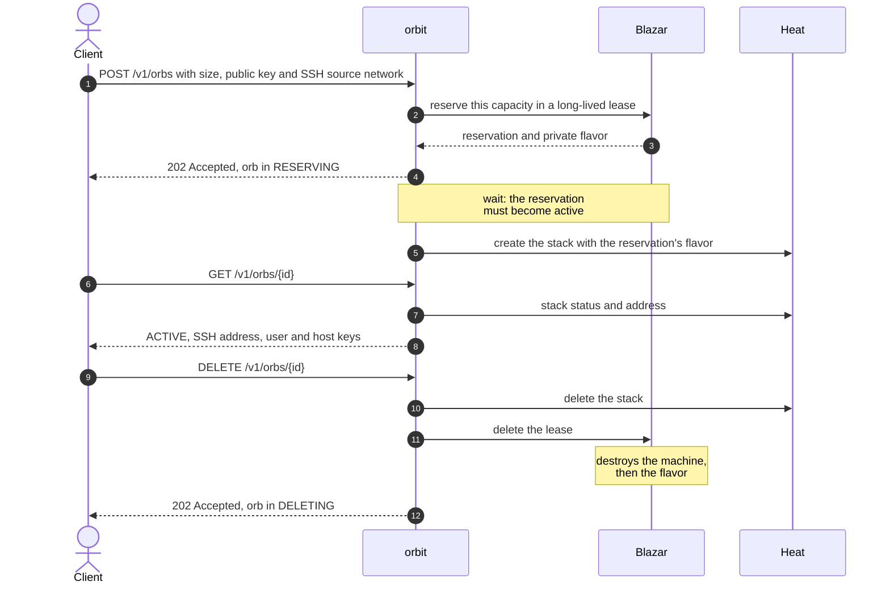

<p align="center">
  
</p>

<h1 align="center">orbit</h1>

<p align="center">
  
  
  
  <br>
  
  
</p>

**Ephemeral sandboxes as an OpenStack service.** A client asks for "a machine with these resources"; the service hands it over isolated and reachable over SSH, and when the client is done it makes it disappear entirely. Each sandbox is an **orb**.

---

## Features

- **Custom size**: processors, memory and disk are chosen orb by orb, without catalogs of fixed sizes.
- **Reserved capacity**: capacity is reserved before building, so a request without room fails right away instead of halfway.
- **Requester's project**: the orb is created in the project of whoever asks for it, among their resources and within their quota.
- **Verified SSH access**: the orb gets the client's public key, and the client gets address, user and the machine's host keys to verify whom it connects to.
- **SSH source network**: SSH is admitted only from the network the client names in each request, one address or a small network, within an optional cap set by the operator.
- **Default-deny egress**: outbound connections are denied by default. External hostnames are reachable only through the operator's egress proxy, which admits its allowed domains; without a proxy, an orb reaches only the addresses and ports the operator lists ([outbound access](docs/egress.md)).
- **Complete deletion**: one repeatable operation deletes capacity, flavor, machine and surrounding resources.
- **Truthful status**: every read looks at the real resources, so a machine deleted by hand does not leave behind an orb that lies.

---

## Lifecycle of an orb



---

## Interface

Clients use the [REST API](docs/design/api.md), `/v1/orbs`. Agents can follow the [orbit skill](skills/orbit/SKILL.md) for the create, work and cleanup procedure. People watch the orbs in Horizon, in the read-only **Project → Orbit → Orbs** panel.

---

## Installation

Use an aarch64 host: every orb boots the same aarch64 image, which `stack.sh` downloads and uploads to Glance ([0010](docs/adr/0010-one-orb-image.md)).

1. Clone DevStack:

   ```console
   $ git clone https://opendev.org/openstack/devstack
   $ cd devstack
   ```

2. Write `local.conf`, enabling orbit after the Heat and Blazar plugins it depends on:

   ```console
   $ cat > local.conf <<'EOF'
   [[local|localrc]]
   ADMIN_PASSWORD=secret
   DATABASE_PASSWORD=$ADMIN_PASSWORD
   RABBIT_PASSWORD=$ADMIN_PASSWORD
   SERVICE_PASSWORD=$ADMIN_PASSWORD
   enable_plugin heat   https://opendev.org/openstack/heat
   enable_plugin blazar https://opendev.org/openstack/blazar
   # Without a branch, DevStack fetches master, which orbit does not have.
   enable_plugin orbit  https://github.com/taekwondodev/orbit main
   # Optional: the egress proxy that admits external hostnames.
   ORBIT_EGRESS_PROXY=True
   EOF
   ```

3. Install:

   ```console
   $ ./stack.sh
   ```

4. Check that the egress proxy enabled in `local.conf` is running. To change the hostnames it admits, follow [outbound access](docs/egress.md):

   ```console
   $ systemctl status devstack@orbit-egress-proxy
   ```

5. If the agent runs on another machine, make the orbs reachable from there by running this on it; its header says when to run it again:

   ```console
   $ tools/reach-orbs.sh <host>
   ```

6. Give the agent the [orbit skill](skills/orbit/SKILL.md) and the credentials of a project.

7. Watch the agent's orbs in Horizon. DevStack gives `demo` no default project, so Horizon may open `invisible_to_admin`, where the list is empty; pick `demo` in the project menu at the top:

   ```text
   URL:      http://<host>/dashboard
   User:     demo
   Password: the ADMIN_PASSWORD in local.conf
   Project:  demo
   Panel:    Project → Orbit → Orbs
   ```

What each plugin does and what the installation requires: [docs/architecture.md](docs/architecture.md#installation).

## Tests

```console
$ tox -e py3          # unit tests, no OpenStack needed
$ tox -e genconfig    # regenerate etc/orbit.conf.sample
$ tox -e dashboard    # Horizon panel tests
```

---

## Documents

| Document | Content |
| --- | --- |
| [GLOSSARY](GLOSSARY.md) | glossary of the domain and of the OpenStack terms used |
| [Architecture](docs/architecture.md) | ownership boundaries, composition of an orb, full sequence, installation requirements |
| [Outbound access](docs/egress.md) | what an orb can reach, the egress proxy's domains, listed destinations |
| [API contract](docs/design/api.md) | HTTP resources, statuses, errors |
| [orbit skill](skills/orbit/SKILL.md) | how an agent creates, uses and deletes an orb |
| [Stored state](docs/design/state.md) | the service's table and reconciliation |
| [Orb template](orbit/templates/orb.yaml) | Heat description of an orb's resources |
| [Decisions](docs/adr/) | the shape choices, with rejected alternatives and sources |
