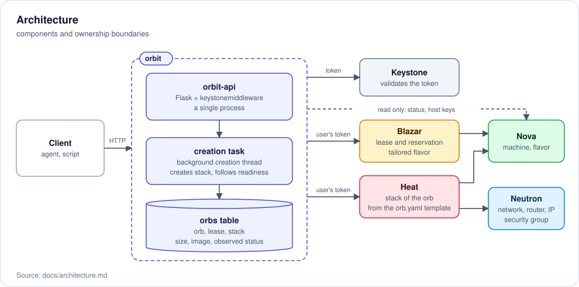
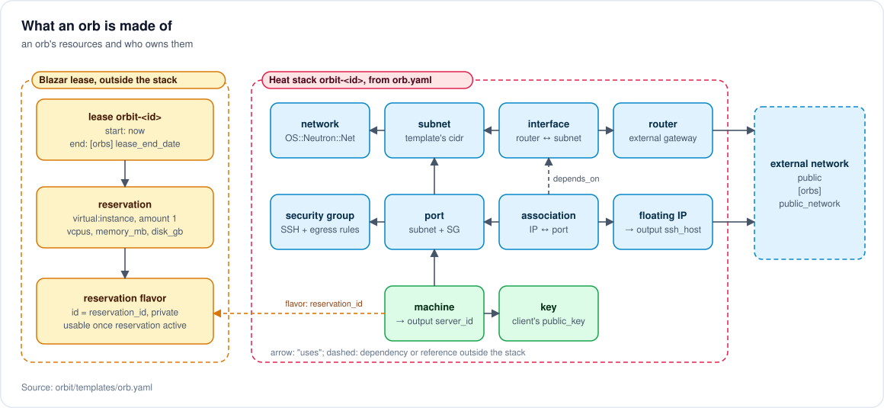
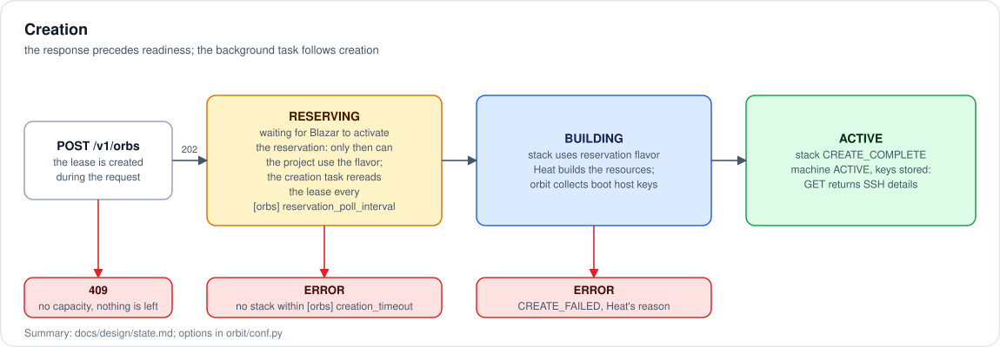
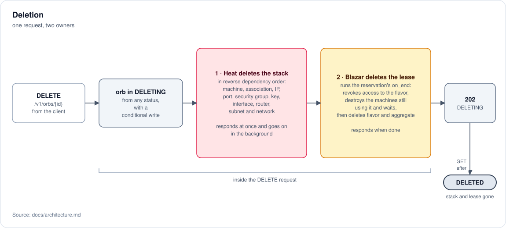
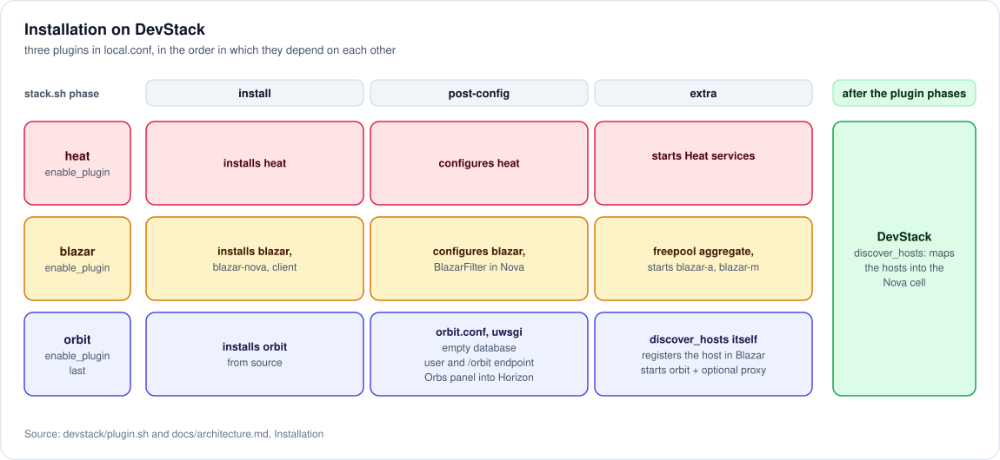

# Architecture

Who does what, where the ownership boundary runs and in which order things happen. The choices that produced this shape are recorded in [docs/adr](adr/); this document describes the result.

## Components

| Component | Responsibility | Does not |
| --- | --- | --- |
| `orbit-api` | authenticates and validates HTTP requests, creates leases, reconciles reads, requests stack and lease deletion | persist tokens, act without requester authorization |
| creation task | background thread inside `orbit-api`: waits for reservation activation, creates the stack and follows SSH readiness using the request's token | survive a process restart or token expiry |
| `orbs` table | the link between orb, lease and stack, the size and SSH network, the observed status, the host keys read at boot | hold the truth about the resources |
| Orbs panel | inside Horizon, under Project → Orbit: lists and shows the project's orbs through `orbit-api`, with the logged-in user's token | create or delete orbs, call anything but `orbit-api` |

The creation task remains in the request-serving process with the request's token in memory. Authorization and restart trade-offs are recorded in [0002](adr/0002-resources-in-the-users-project.md); the creation deadlines and background following are defined in [reconciliation](design/state.md#reconciliation). Option values belong to [orbit/conf.py](../orbit/conf.py).

## Ownership boundary

Calls to Blazar, Heat and Nova use the requester's authorization ([0002](adr/0002-resources-in-the-users-project.md)). Blazar owns capacity and flavor; Heat owns the resources in the [template](../orbit/templates/orb.yaml). orbit reads Nova for machine status and console output, and does not write to Nova or Neutron directly ([0001](adr/0001-provisioning-delegated-to-heat.md)). Add new orb resources to the template rather than introducing direct provisioning.

What the service does not do, such as entering the orb or deciding when it ends, is in the [README](../README.md#what-it-does-not-do).

## Composition of an orb

The resources are those of the [template](../orbit/templates/orb.yaml). Why the lease sits outside the stack: [0005](adr/0005-lease-beside-the-stack.md); why each orb has its own network: [0006](adr/0006-own-network-per-orb.md); why its outbound traffic is denied except towards listed destinations: [0009](adr/0009-default-deny-egress.md).

## Sequence of an orb

The calls between client, orbit, Blazar and Heat are in the sequence diagram in the [README](../README.md#lifecycle-of-an-orb); here, what happens over time and what destroys what.

The wait between lease and stack is required by [0005](adr/0005-lease-beside-the-stack.md). Deletion requests ask Heat to delete the stack before asking Blazar to delete the lease; the lease's machine and flavor cleanup is described in [0004](adr/0004-size-as-blazar-reservation.md). Detailed status observations belong to [reconciliation](design/state.md#reconciliation); the diagrams here summarize those contracts.

## Installation

The [DevStack plugin](../devstack/plugin.sh) implements installation and cleanup. The [README](../README.md#installation) owns the operator's installation procedure; this section records ordering constraints and deployment gotchas.

Besides its own processes, the plugin must:

- declare the dependency on the Heat and Blazar plugins, which must be enabled earlier in `local.conf`;
- register the service and its endpoint in the Keystone catalog;
- register the compute host in Blazar, without which no lease can be created;
- leave Blazar's `max_lease_duration` at its default `-1`, which does not limit the duration of leases;
- when Horizon is enabled, copy the panel's enabled files into Horizon in the `post-config` phase, which `stack.sh` runs before Horizon compresses its static files and starts;
- when the egress proxy is enabled, configure it in `extra`, after DevStack assigns the public subnet's gateway address to the host and before orbit-api reads its proxy setting. The [plugin](../devstack/plugin.sh) owns the setup; [settings](../devstack/settings) defines the proxy options and defaults; [outbound access](egress.md) is the operator's procedure for changing them. The placement and security trade-offs are recorded in [0009](adr/0009-default-deny-egress.md).

Host registration happens in the `extra` phase, but DevStack maps hosts into the Nova cell only after that phase, and the Nova API does not show unmapped hypervisors. The plugin therefore runs `nova-manage cell_v2 discover_hosts`, which is repeatable, before looking them up.

Once the host is registered, Nova's `BlazarFilter` reserves it for reservations: a request without a reservation does not pass on a host that belongs to a Blazar aggregate, `freepool` included. On a single-host DevStack, machines created outside orbit find no room. Source: `host_passes` in <https://opendev.org/openstack/blazar-nova/src/branch/master/blazarnova/scheduler/filters/blazar_filter.py>

### Images other than CirrOS

The plugin configures only DevStack's default image. Before using another image, check:

- **The SSH user.** Match the image's user through `[orbs] ssh_users` if it differs from `default_ssh_user`; the options are defined in [orbit/conf.py](../orbit/conf.py). `stack.sh` rewrites `orbit.conf` and deletes Glance images, so restore the mapping when uploading the image again.
- **Boot data and host keys.** The image must read the config drive requested by the [template](../orbit/templates/orb.yaml), install the client's key and publish its host keys on the console as required by [0007](adr/0007-host-keys-read-once-from-the-console.md). A config drive also avoids depending on OpenStack SMBIOS discovery when running aarch64 guests under QEMU without KVM.
- **Proxy setup, when configured.** The image's initializer must apply the cloud-config `write_files` generated by [orbit/egress.py](../orbit/egress.py) before sshd starts. sshd must include `sshd_config.d`, and sudo must include `sudoers.d`. With tiny-cloud, allow `save_userdata` and `organize_userdata` to run by leaving them out of `SKIP_INIT_ACTIONS`. CirrOS ignores this user data, so enabling the proxy alone does not configure its tools.

The [image build guide](../tools/image/README.md) covers the repository's Alpine image. Before adopting another image, create an orb with it, wait for `ACTIVE`, connect using the returned host keys, and, if a proxy is configured, check that an SSH command receives the proxy environment, sudo preserves it and a required HTTPS dependency is reachable. Delete the test orb afterward, including if a check fails.
