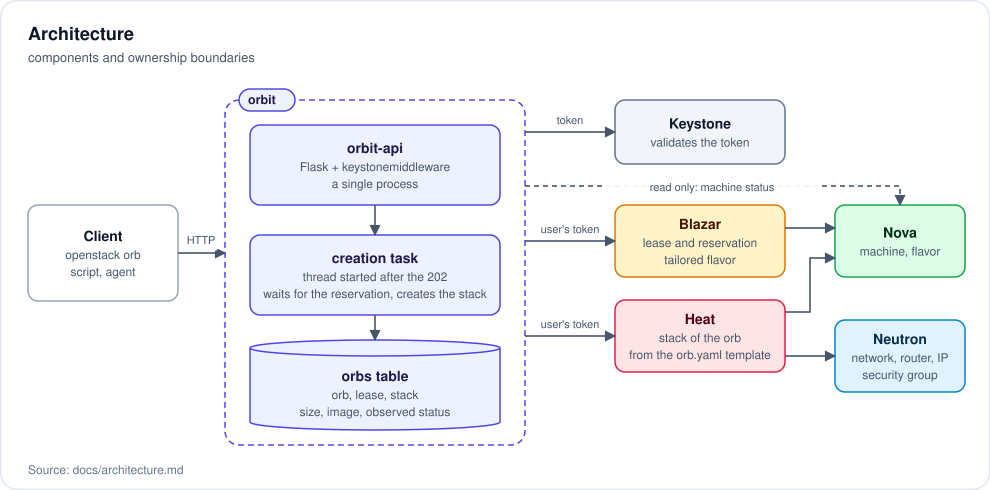
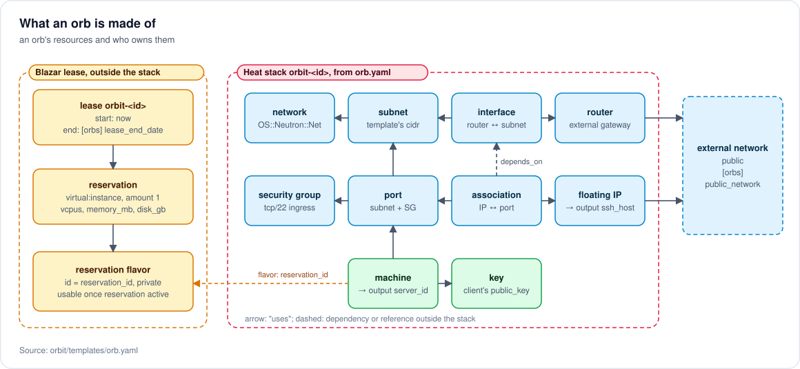
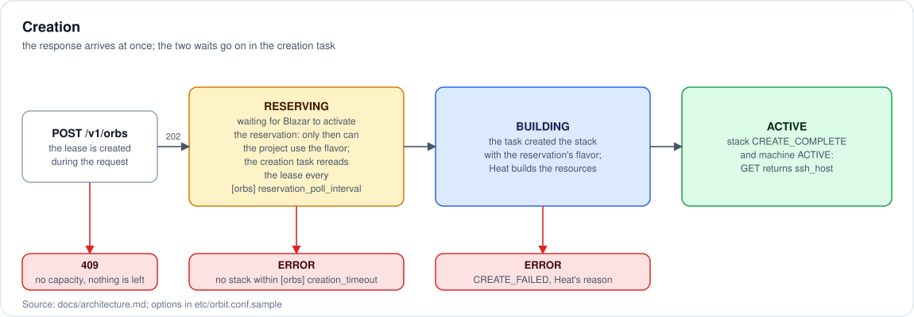
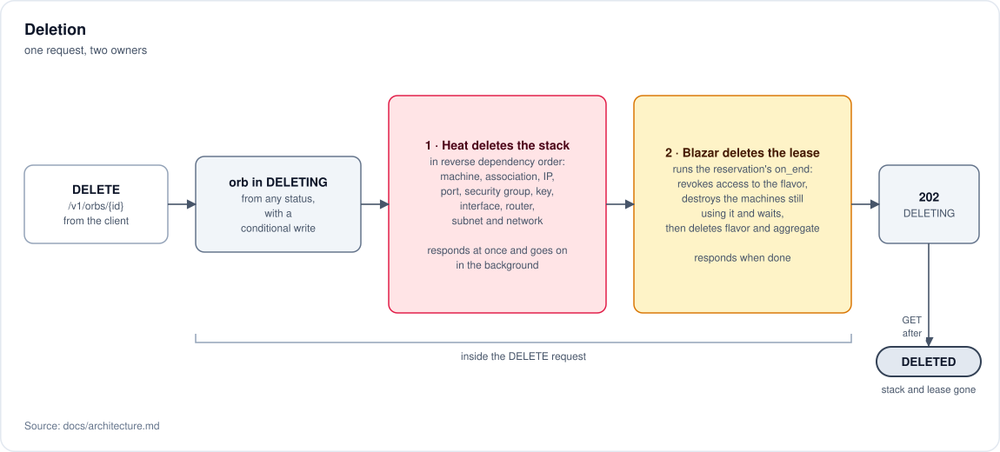
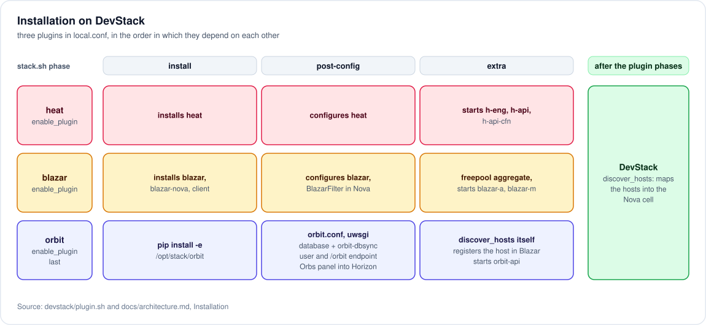

# Architecture

Who does what, where the ownership boundary runs and in which order things happen. The choices that produced this shape are recorded in [docs/adr](adr/); this document describes the result.

## Components

| Component | Responsibility | Does not |
| --- | --- | --- |
| `orbit-api` | receives HTTP requests, authenticates the token, validates, creates the lease, reads the real status on every request, deletes stack and lease | keep tokens, act without a request from the user |
| creation task | inside `orbit-api`, after the response: waits for the reservation to be active and creates the stack with the request's token | survive a process restart |
| `orbs` table | the link between orb, lease and stack, the size, the observed status | hold the truth about the resources |

There is a single process. The work after the response lasts a few seconds, the time Blazar takes to activate the reservation, and uses the request's token: a separate process with a queue would only be needed if that work had to survive restarts, and it would then have to keep a delegation ([0002](adr/0002-resources-in-the-users-project.md)).

## Ownership boundary

Every call to Blazar and Heat uses the user's token. The service has no privileges of its own over users' resources.

The rule that must not be broken, because it is the point of the project: **the service does not create resources by itself.** It does not call Nova or Neutron for writes. Blazar creates the capacity and the flavor, Heat the rest. If the orb ever needs one more resource, it is added to the template.

What the service does not do, such as entering the orb or deciding when it ends, is in the [README](../README.md#what-it-does-not-do).

## Composition of an orb

The resources are those of the [template](../orbit/templates/orb.yaml). Why the lease sits outside the stack: [0005](adr/0005-lease-beside-the-stack.md); why each orb has its own network: [0006](adr/0006-own-network-per-orb.md).

## Sequence of an orb

The calls between client, orbit, Blazar and Heat are in the sequence diagram in the [README](../README.md#lifecycle-of-an-orb); here, what happens over time and what destroys what.

The step that needs care is the wait between lease and stack: the reservation's flavor exists right away, but the project can use it only once the reservation is active ([0005](adr/0005-lease-beside-the-stack.md)). On deletion, instead, Blazar guarantees the order: it destroys the machine, waits until it no longer exists, and only then deletes the flavor.

## Installation

The service is installed as a DevStack plugin: a repository with a `devstack/` folder containing `settings` (which declares the plugin and enables the services) and `plugin.sh`, called in the `install`, `post-config` and `extra` phases of `stack.sh`, plus `unstack` and `clean`.

Besides its own processes, the plugin must:

- declare the dependency on the Heat and Blazar plugins, which must be enabled earlier in `local.conf`;
- register the service and its endpoint in the Keystone catalog;
- register the compute host in Blazar, without which no lease can be created;
- leave Blazar's `max_lease_duration` at its default `-1`, which does not limit the duration of leases.

Host registration happens in the `extra` phase, but DevStack maps hosts into the Nova cell only after that phase, and the Nova API does not show unmapped hypervisors. The plugin therefore runs `nova-manage cell_v2 discover_hosts`, which is repeatable, before looking them up.

Once the host is registered, Nova's `BlazarFilter` reserves it for reservations: a request without a reservation does not pass on a host that belongs to a Blazar aggregate, `freepool` included. On a single-host DevStack, machines created outside orbit find no room. Source: `host_passes` in <https://opendev.org/openstack/blazar-nova/src/branch/master/blazarnova/scheduler/filters/blazar_filter.py>
