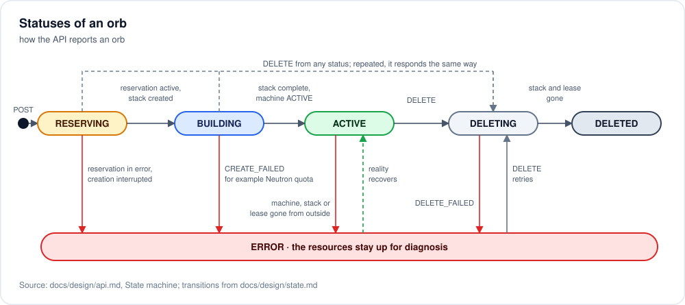
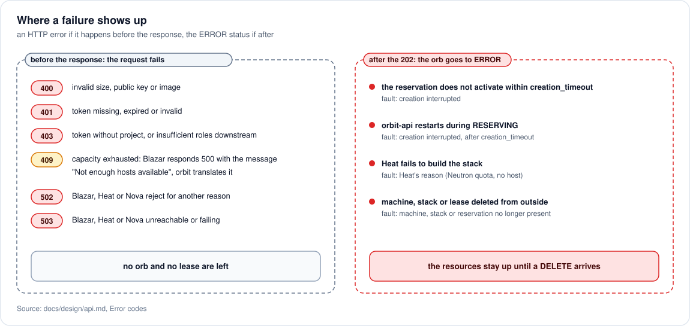

# API contract

Implemented in `orbit/api/v1.py`. Every request needs a Keystone token in the `X-Auth-Token` header; orbs are visible only within the project they belong to.

## Resources

| Method and path | Body | Response |
| --- | --- | --- |
| `POST /v1/orbs` | `{size, public_key, image?}` | `202` with the orb in status `RESERVING` |
| `GET /v1/orbs` | `?status=` filters | `200` with the list of the project's orbs |
| `GET /v1/orbs/{id}` | — | `200` with status, address and any error |
| `DELETE /v1/orbs/{id}` | — | `202` with the orb in status `DELETING`, repeatable without error |

### Creation

```json
{
  "size": { "vcpus": 2, "memory_mb": 4096, "disk_gb": 20 },
  "public_key": "ssh-ed25519 AAAA...",
  "image": "ubuntu-24.04"
}
```

`size` goes unchanged into the Blazar reservation ([0004](../adr/0004-size-as-blazar-reservation.md)): it is the "every orb with different resources" requirement, expressed where it takes effect. Each value is capped by a configured maximum; beyond it the response is `400`.

`public_key` is mandatory. The service does not generate key pairs and never sees a private key: a deliberate choice so that it has no user secrets to hand over or to guard.

The response arrives once the capacity is reserved, before the resources exist: progress is followed with `GET`. What happens after the response is in [architecture](../architecture.md#sequence-of-an-orb).

### Read

```json
{
  "id": "0d0b...",
  "status": "ACTIVE",
  "size": { "vcpus": 2, "memory_mb": 4096, "disk_gb": 20 },
  "image": "ubuntu-24.04",
  "ssh_host": "172.24.4.17",
  "ssh_user": "ubuntu",
  "ssh_host_keys": [
    "ecdsa-sha2-nistp256 AAAAE2VjZHNh...",
    "ssh-ed25519 AAAAC3NzaC1lZDI1NTE5..."
  ],
  "fault": null,
  "created_at": "2026-10-20T12:00:00"
}
```

The returned status is that of the real resources, derived on every read ([reconciliation](state.md#reconciliation)). `ssh_host` is set only in status `ACTIVE`. `ssh_user` depends on the image and comes from the service configuration (`[orbs] ssh_users`). `ssh_host_keys` are the machine's SSH host keys, `type base64` without comment, `null` until the machine has printed them on its console at boot ([0007](../adr/0007-host-keys-read-once-from-the-console.md)). The client writes them to `known_hosts` as `<ssh_host> <key>` and connects with strict host key checking. `fault` carries the reason when the status is `ERROR`, taken from whoever produced it (the rejected reservation, the failed stack) and not rewritten. The lease's end date does not appear: it is not an expiry.

### Deletion

Moves the orb to `DELETING` and starts destroying all of its resources; the orb becomes `DELETED` when none is left. On an orb already in `DELETING` or `DELETED`, or whose resources are already gone, it responds the same way. The order of destruction is in [architecture](../architecture.md#sequence-of-an-orb).

## State machine



| Status | Meaning |
| --- | --- |
| `RESERVING` | lease created, waiting for the reservation to become active |
| `BUILDING` | stack being built, or machine booting until it publishes its host keys |
| `ACTIVE` | machine reachable over SSH, address and host keys available |
| `ERROR` | something failed or was changed from outside; the resources stay up for inspection |
| `DELETING` | deletion requested, in progress |
| `DELETED` | stack and lease removed, row kept |

How a read derives the status from the real resources is in [stored state](state.md#reconciliation).

`RESERVING` and `BUILDING` are distinct waits because the stack cannot be created before the reservation is active ([0005](../adr/0005-lease-beside-the-stack.md)).

An orb in `ERROR` does **not** delete itself. It is a choice in favor of diagnosis: the resources stay observable until someone calls `DELETE`.

## Error codes



| Code | When |
| --- | --- |
| `400` | size or public key missing, malformed or beyond the limits; no image given or configured; `?status=` filter with an unknown status |
| `401` | token missing, expired or invalid, also when Blazar, Heat or Nova reject it downstream |
| `403` | token without project scope, because an orb always belongs to a project; or insufficient roles for Blazar, Heat or Nova |
| `404` | orb that does not exist or belongs to another project (indistinguishable on purpose) |
| `409` | exhausted capacity: Blazar rejected the reservation. Blazar does not use a dedicated code: it responds `500` with the message `Not enough hosts available` ([`NotEnoughHostsAvailable`](https://opendev.org/openstack/blazar/src/branch/master/blazar/manager/exceptions.py) declares no code, and [the API layer](https://opendev.org/openstack/blazar/src/branch/master/blazar/api/v1/utils.py) forwards it as is), and the service recognizes it from the message. |
| `502` | Blazar, Heat or Nova rejected the request for a reason the service cannot translate; the message carries theirs |
| `503` | Blazar, Heat or Nova unreachable or failing; the details stay in the service logs, because they may contain internal addresses |

Since the lease is created during the request, missing capacity is an error of the request and leaves no orb behind. A build failure, including an exhausted project quota, shows up instead as `ERROR` on the orb with the reason reported by Heat: the stack is created after the `202` response.
