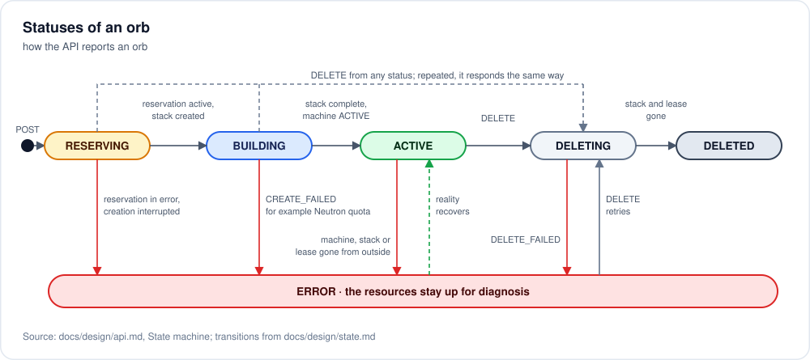
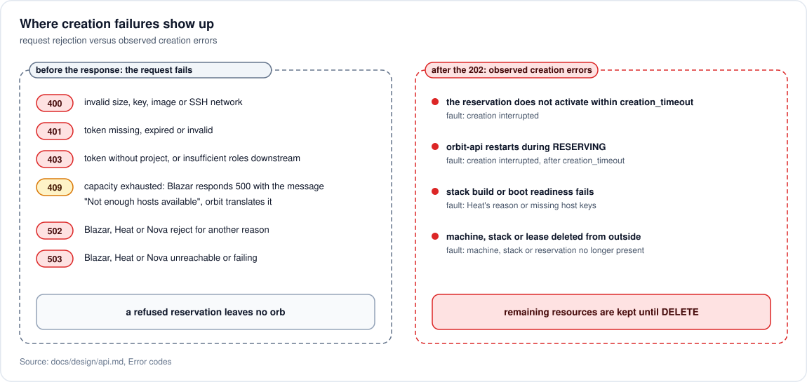

# API contract

Implemented in [orbit/api/v1.py](../../orbit/api/v1.py). Every request needs a Keystone token in the `X-Auth-Token` header; orbs are visible only within the project they belong to.

## Resources

| Method and path | Input | Response |
| --- | --- | --- |
| `POST /v1/orbs` | `{size, public_key, ssh_allowed_cidr}` | `202` with the orb in status `RESERVING` |
| `GET /v1/orbs` | `?status=` filters | `200` with the list of the project's orbs |
| `GET /v1/orbs/{id}` | None | `200` with status, address and any error |
| `DELETE /v1/orbs/{id}` | None | `202` with status `DELETING` or, if already gone, `DELETED`; repeatable |

### Creation

The body must be a JSON object; other body shapes return `400`.

```json
{
  "size": { "vcpus": 2, "memory_mb": 4096, "disk_gb": 20 },
  "public_key": "ssh-ed25519 AAAA...",
  "ssh_allowed_cidr": "198.51.100.20/32"
}
```

`size` requires positive integer `vcpus`, `memory_mb` and `disk_gb` values, each within its configured maximum; otherwise the response is `400`. Configuration options and defaults are defined in [orbit/conf.py](../../orbit/conf.py). Why size is a reservation: [0004](../adr/0004-size-as-blazar-reservation.md).

`public_key` is a required OpenSSH public key string. The service does not generate key pairs and never sees a private key: a deliberate choice so that it has no user secrets to hand over or to guard.

`ssh_allowed_cidr` is mandatory: the network the orb's firewall admits SSH from, as an IPv4 CIDR; a bare address admits that address only. CIDRs must use their network address: `198.51.100.0/24` is valid syntax, while `198.51.100.20/24` returns `400` because host bits are set. It cannot be wider than `[orbs] ssh_min_prefix`, and when the operator sets `[orbs] ssh_allowed_cidr` it must lie inside that network; otherwise the response is `400`. Why the client names it: [0008](../adr/0008-ssh-network-named-by-the-request.md).

Every orb boots the same image, so the request names none ([0010](../adr/0010-one-orb-image.md)). Fields other than these are ignored.

The response accepts creation once capacity is reserved, without waiting for resource readiness. The background task can start before the HTTP response is sent. Follow progress with `GET`; see [architecture](../architecture.md#sequence-of-an-orb) for the sequence.

### Read

```json
{
  "id": "0d0b...",
  "status": "ACTIVE",
  "size": { "vcpus": 2, "memory_mb": 4096, "disk_gb": 20 },
  "ssh_host": "172.24.4.17",
  "ssh_user": "ubuntu",
  "ssh_allowed_cidr": "198.51.100.20/32",
  "ssh_host_keys": [
    "ecdsa-sha2-nistp256 AAAAE2VjZHNh...",
    "ssh-ed25519 AAAAC3NzaC1lZDI1NTE5..."
  ],
  "fault": null,
  "created_at": "2026-10-20T12:00:00"
}
```

The returned status follows [reconciliation](state.md#reconciliation). `ssh_host` is set only in status `ACTIVE`. `ssh_user` is the user the orb image creates. `ssh_host_keys` are the machine's SSH host keys, `type base64` without comment, `null` until collected within the boot trust window in [0007](../adr/0007-host-keys-read-once-from-the-console.md). Collected keys remain stored even if the orb later leaves `ACTIVE`. The [orbit skill](../../skills/orbit/SKILL.md#4-work-inside-the-orb) owns the SSH connection procedure. `fault` carries an upstream reason when available or a service-generated explanation, such as an interrupted creation. The lease's end date is omitted because it is not a client-visible expiry ([0003](../adr/0003-no-expiry.md)).

A list read returns `{"orbs": [...]}`. It includes deleted history and reconciles the project's orbs before applying the optional `?status=<status>` filter.

### Deletion

Moves the orb to `DELETING` and requests resource deletion. Reads report `DELETED` once the stack and lease are gone. A repeated request retries remaining deletion work; an already `DELETED` orb stays `DELETED`. Both cases return `202`. The order of destruction is in [architecture](../architecture.md#sequence-of-an-orb).

## State machine



| Status | Meaning |
| --- | --- |
| `RESERVING` | lease created, waiting for the reservation to become active |
| `BUILDING` | stack being built, or machine booting until it publishes its host keys |
| `ACTIVE` | Nova reports the machine active, and its address and boot host keys are available; client-side SSH reachability is not probed |
| `ERROR` | something failed or was changed from outside; the resources stay up for inspection |
| `DELETING` | deletion requested, in progress |
| `DELETED` | stack and lease removed, row kept |

How a read derives the status from the real resources is in [stored state](state.md#reconciliation).

`RESERVING` and `BUILDING` are distinct waits because the stack cannot be created before the reservation is active ([0005](../adr/0005-lease-beside-the-stack.md)).

An orb in `ERROR` retains any remaining resources for diagnosis until someone calls `DELETE`.

## Error codes

Errors use `{"error": {"code": <HTTP status>, "message": <description>}}`.



| Code | When |
| --- | --- |
| `400` | invalid creation body or fields as specified above; `?status=` filter with an unknown status |
| `401` | token missing, expired or invalid, also when Blazar, Heat or Nova reject it downstream |
| `403` | token without project scope, because an orb always belongs to a project; or insufficient roles for Blazar, Heat or Nova |
| `404` | orb that does not exist or belongs to another project (indistinguishable on purpose) |
| `409` | exhausted capacity: Blazar rejected the reservation. Blazar does not use a dedicated code: it responds `500` with the message `Not enough hosts available` ([`NotEnoughHostsAvailable`](https://opendev.org/openstack/blazar/src/branch/master/blazar/manager/exceptions.py) declares no code, and [the API layer](https://opendev.org/openstack/blazar/src/branch/master/blazar/api/v1/utils.py) forwards it as is), and the service recognizes it from the message. |
| `502` | Blazar, Heat or Nova rejected the request for a reason the service cannot translate; the message carries theirs |
| `503` | Blazar, Heat or Nova unreachable or failing; the details stay in the service logs, because they may contain internal addresses |

Since the lease is created during the request, missing capacity is an error of the request and leaves no orb behind. A build failure, including an exhausted project quota, shows up instead as `ERROR` on the orb with the reason reported by Heat: the stack is created after the `202` response.
