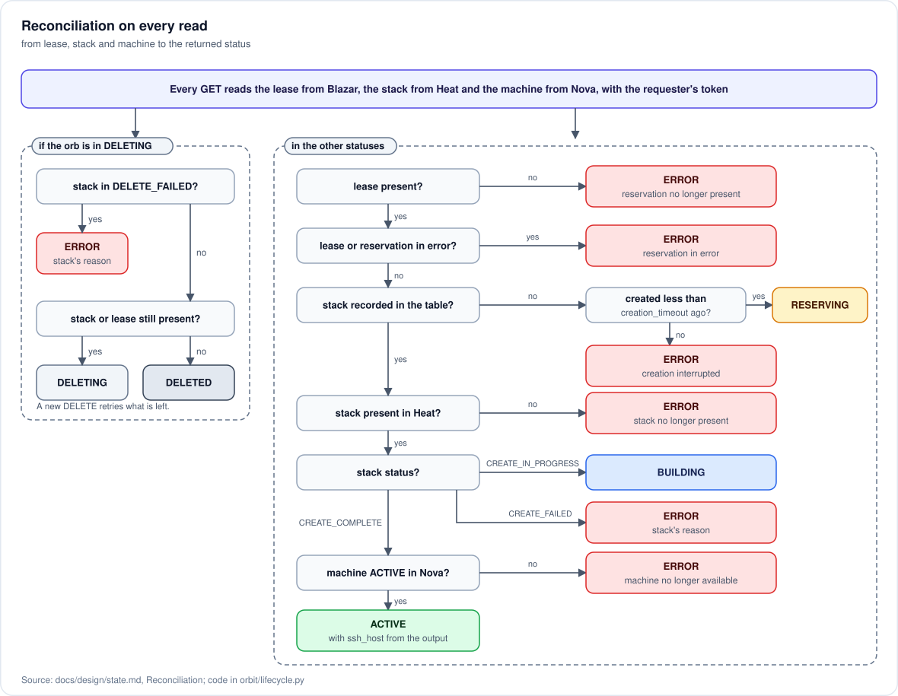

# Stored state

Implemented in `orbit/db/api.py` and `orbit/lifecycle.py`. The principle that governs it: **we store only what we own**. Everything else is asked of whoever owns it.

## What belongs to others

| Information | Owner | How we get it |
| --- | --- | --- |
| granted capacity and reservation status | Blazar | lease |
| flavor of the size | Blazar | reservation identifier |
| existence and outcome of the resources | Heat | stack status |
| SSH address | Heat | stack output |
| existence and status of the machine | Nova | the machine named by the stack output |
| identity and roles of the consumer | Keystone | request token |

## The `orbs` table

```
id                  uuid        primary key, the orb's public identifier
project_id          string      the consumer's project, filter of every read
user_id             string      who requested the orb
vcpus               int         the requested size
memory_mb           int
disk_gb             int
image               string      the requested image, which determines the SSH user
lease_id            uuid        the Blazar lease
reservation_id      uuid        the reservation inside that lease, used as flavor
stack_id            uuid        the Heat stack, empty until it is created
status              enum        see the state machine in the API contract
fault               text        reason for the error, copied from whoever produced it
created_at          timestamp
updated_at          timestamp
deleted_at          timestamp   kept for history
```

The table exists because the service owns three things nobody else keeps: the link between an orb, its lease and its stack; the requested size and image, which outlive the lease; the history of deleted orbs. Two columns are declared copies:

- `status` is a copy of the last observation. Every read recomputes it from Blazar, Heat and Nova and writes it back; it is used to filter the list.
- `fault` is a copy of the reason for someone else's failure, kept because the failed stack might be deleted before anyone reads the orb.

No secret is stored: the service keeps neither tokens nor delegations ([0002](../adr/0002-resources-in-the-users-project.md)).

## Reconciliation



Every read of an orb, single or in a list, compares what the table claims with what Blazar, Heat and Nova show with the requester's token, and corrects the table. Not the other way around: if reality and the table diverge, reality is right.

| Observation | Resulting status |
| --- | --- |
| lease waiting for activation | `RESERVING` |
| no stack, orb created less than the wait limit ago | `RESERVING` |
| no stack, orb created more than the wait limit ago | `ERROR`, creation interrupted |
| lease in error | `ERROR`, reason from the lease |
| stack `CREATE_IN_PROGRESS` | `BUILDING` |
| stack `CREATE_COMPLETE`, machine `ACTIVE` | `ACTIVE` |
| stack `CREATE_FAILED` | `ERROR`, reason from the stack |
| stack `CREATE_COMPLETE`, machine missing or not `ACTIVE` | `ERROR`, machine no longer available |
| lease missing, orb not in `DELETING` | `ERROR`, reservation no longer present |
| stack missing after being created, orb not in `DELETING` | `ERROR`, stack no longer present |
| orb in `DELETING`, stack or lease still present | `DELETING` |
| orb in `DELETING`, stack and lease missing | `DELETED` |
| stack `DELETE_FAILED` | `ERROR`, reason from the stack; a new `DELETE` retries |

An orb already in `ERROR` that stays in error keeps the first reason, which is the one useful for diagnosis; if instead reality recovers, for example a stopped machine is started again, the orb goes back to `ACTIVE`. During deletion the stack is looked up by name even if the orb has not recorded one: the creation task might have created it without managing to write it down.

The machine must be read in addition to the stack because Heat does not notice a machine deleted or stopped from outside: the stack stays `CREATE_COMPLETE`. The lease must be read because, if someone deletes it by hand, Blazar destroys the machine.

The task that waits for the reservation and creates the stack lives only in memory, in the process that received the request: no other process can know whether it is still running. That is why the criterion is time: an orb without a stack beyond the configured wait limit is considered interrupted, and the task itself gives up when the same limit expires.

Every action is repeatable without harm: deleting a stack or a lease already deleted and re-reading resources that are gone must lead to the same result.

## Deterministic names

An orb's lease and stack are both named `orbit-<orb_id>`, and the stack carries the `orbit` tag. The names make it possible to find an orb's resources even if the write to the table did not succeed, and make a second attempt recognizable instead of producing a duplicate; the tag makes it possible to read all the stacks of a project's orbs with a single call to Heat.
