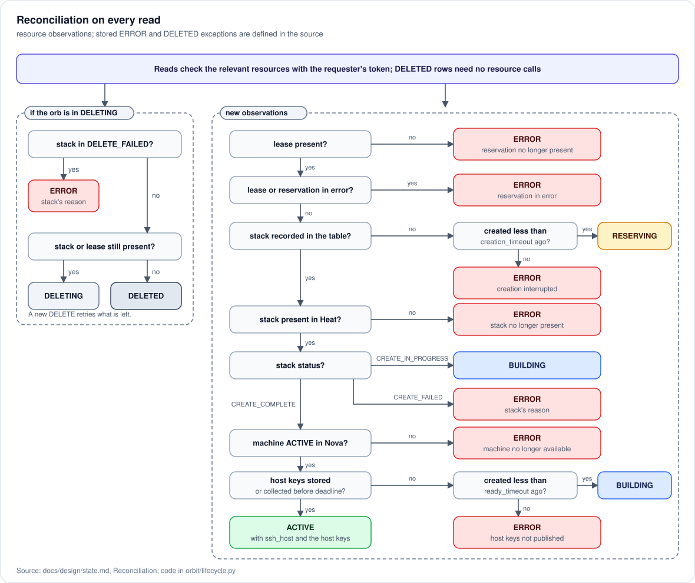

# Stored state

Implemented in [the repository](../../orbit/db/api.py), [lifecycle observations](../../orbit/lifecycle.py) and [reconciliation](../../orbit/reconciliation.py). The principle that governs it: **we store only what we own**. Everything else is asked of whoever owns it.

## What belongs to others

| Information | Owner | How we get it |
| --- | --- | --- |
| granted capacity and reservation status | Blazar | lease |
| flavor of the size | Blazar | reservation identifier |
| existence and outcome of the resources | Heat | stack status |
| SSH address | Heat | stack output |
| SSH host keys | the machine | its console, read once at boot and stored ([0007](../adr/0007-host-keys-read-once-from-the-console.md)) |
| existence and status of the machine | Nova | the machine named by the stack output |
| identity and roles of the consumer | Keystone | request token |

## The `orbs` table

The schema and column types are defined in [orbit/db/api.py](../../orbit/db/api.py). Public fields and status meanings belong to the [API contract](api.md); this document owns storage rationale and reconciliation behavior.

The table exists because the service owns three things nobody else keeps: the link between an orb, its lease and its stack; the requested size, image and SSH network, which outlive the lease; the history of deleted orbs. Three columns are declared copies:

- `status` caches the last observation and guards concurrent updates. A changed observation is written back.
- `fault` preserves an upstream or service-generated failure reason because the resource that explains it may disappear before the next read.
- `ssh_host_keys` is a copy of what the machine printed on its console at boot, written once because the console is not a reliable owner ([0007](../adr/0007-host-keys-read-once-from-the-console.md)).

No secret is stored: the service keeps neither tokens nor delegations ([0002](../adr/0002-resources-in-the-users-project.md)).

## Reconciliation

Except for terminal `DELETED` rows, reads compare stored state with the relevant Blazar, Heat and Nova resources using the requester's token, and correct the table. The diagram summarizes the observation rules below; the resources, not the cached status, determine the result.

Apply the first matching row. Terminal and deletion handling precede lease checks; lease failures precede stack observations.

| Observation | Resulting status |
| --- | --- |
| already `DELETED` | `DELETED`, without querying resources |
| orb in `DELETING`, stack `DELETE_FAILED` | `ERROR`, reason from the stack; a new `DELETE` retries |
| orb in `DELETING`, stack or lease still present | `DELETING` |
| orb in `DELETING`, stack and lease missing | `DELETED` |
| lease missing | `ERROR`, reservation no longer present |
| lease or reservation in error | `ERROR`, reason from the lease |
| no stack recorded, already in `ERROR` | `ERROR`, existing reason |
| no stack recorded, before `creation_timeout` | `RESERVING` |
| no stack recorded, at or after `creation_timeout` | `ERROR`, creation interrupted |
| recorded stack missing | `ERROR`, stack no longer present |
| stack `CREATE_IN_PROGRESS` | `BUILDING` |
| stack `CREATE_COMPLETE`, machine missing or not `ACTIVE` | `ERROR`, machine no longer available |
| stack `CREATE_COMPLETE`, host keys stored or collected within the trust window | `ACTIVE`, keys stored |
| stack `CREATE_COMPLETE`, no host keys, before `ready_timeout` | `BUILDING` |
| stack `CREATE_COMPLETE`, no host keys, at or after `ready_timeout` | `ERROR`, SSH host keys not published on the console |
| stack `CREATE_FAILED` or `DELETE_FAILED` | `ERROR`, reason from the stack |
| any other stack status | `ERROR`, stack status reported |

An orb already in `ERROR` that stays in error keeps the first reason for diagnosis. An error without a recorded stack stays an error. If a recorded stack and its machine recover, the orb can return to `ACTIVE` once the host-key requirement is satisfied. During deletion the stack is looked up by name even if the orb has not recorded one: the creation task might have created it without managing to write it down.

The machine must be read in addition to the stack because Heat does not notice a machine deleted or stopped from outside: the stack stays `CREATE_COMPLETE`. The lease must be read because, if someone deletes it by hand, Blazar destroys the machine.

Host-key collection follows the trust window in [0007](../adr/0007-host-keys-read-once-from-the-console.md), and requires an active machine in a completed stack. A console that cannot be read counts as keys not published yet: the read of the orb does not fail for it.

The creation task uses the process-local authorization model in [0002](../adr/0002-resources-in-the-users-project.md). Since another process cannot know whether that task is still running, a missing recorded stack is judged against `creation_timeout`, counted from the creation request. `ready_timeout` uses the same starting point and must leave time for boot after stack creation; option constraints are defined in [orbit/conf.py](../../orbit/conf.py).

Once the stack exists, the same task reconciles it at `ready_poll_interval` until it leaves `BUILDING`, attempting a final reconciliation at `ready_timeout`. This allows host-key collection without client reads. A service refusal ends background following and leaves further observation to reads; an unreachable service is retried within the following window. These deadlines bound following and host-key collection, not Heat's build duration: a stack still in `CREATE_IN_PROGRESS` can remain `BUILDING` after following stops. A read and the task may reconcile the same orb at once: whichever finds the row already rewritten by the other reconciles again from that row, so a read never returns an orb `ACTIVE` without its address.

Deletion and reconciliation are repeatable: deleting resources already gone and observing them again must converge on the same result.

## Deterministic names

An orb's lease and stack are both named `orbit-<orb_id>`, and the stack carries the `orbit` tag. The names make it possible to find an orb's resources even if the write to the table did not succeed, and make a second attempt recognizable instead of producing a duplicate; the tag labels stacks as orbit-managed. Current reconciliation looks up each stack by its deterministic name, not through a bulk tag query.
